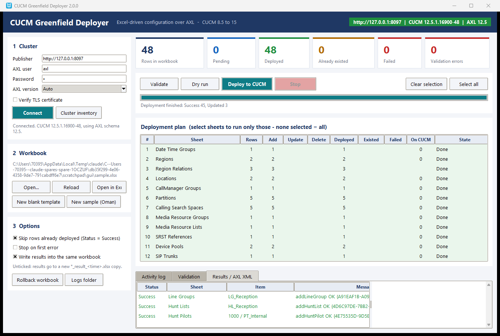

# CUCM Greenfield Deployer

Configure a complete Cisco Unified Communications Manager (CUCM) build from one Excel
workbook. Fill in the sheets, then click **Validate → Dry run → Deploy** in the dashboard.
The tool talks to CUCM over AXL (SOAP) and works with **every CUCM release from 8.5 to 15**.
It detects the AXL version for you.



## What it configures (deploy order)

| # | Sheet | # | Sheet |
|---|-------|---|-------|
| 1 | Date Time Groups | 17 | Translation Patterns |
| 2 | Regions | 18 | Calling Party Xforms |
| 3 | Region Relations (codec/bandwidth matrix) | 19 | Called Party Xforms |
| 4 | Locations (E-LCAC) | 20 | Voicemail Pilots |
| 5 | CallManager Groups | 21 | Voicemail Profiles |
| 6 | Partitions | 22 | Call Pickup Groups |
| 7 | Calling Search Spaces | 23 | Conference Now (11.0+) |
| 8 | Media Resource Groups | 24 | Universal Line Templates (10.0+) |
| 9 | Media Resource Lists | 25 | Universal Device Templates (10.0+) |
| 10 | SRST References | 26 | Directory Numbers |
| 11 | Device Pools | 27 | End Users |
| 12 | SIP Trunks | 28 | Phones (desk phones, Jabber CSF/BOT/TCT) |
| 13 | MGCP Gateways (+ modules) | 29 | End Users: controlled devices + primary extension |
| 14 | Route Groups | 30 | Line Groups |
| 15 | Route Lists | 31 | Hunt Lists |
| 16 | Route Patterns | 32 | Hunt Pilots |

Deletes run first, in reverse order, so you can tear down a build from the same workbook.

## Quick start

```bash
setup.bat
```
`setup.bat` installs `requests`, `lxml` and `openpyxl` and adds Start Menu and Desktop shortcuts.
After that, use **run_app.bat** or the shortcut to start the app.

1. **Cluster**: enter the publisher, an AXL user (needs the *Standard AXL API Access* role) and
   the password, then click **Connect**. Leave the AXL version on *Auto*. The header shows the
   CUCM version and the AXL schema in use. **Cluster inventory** shows how many of each object
   already exist.
2. **Workbook**: click **New blank template** or **New sample (Oman)**, fill it in Excel, then
   click **Reload**.
3. Click **Validate**. It checks required columns, Yes/No and number cells, AXL enum values,
   duplicate rows, and references to objects that are not in the workbook.
4. Click **Dry run**. It builds every AXL request without sending anything. The XML is shown in
   *Results / AXL XML*.
5. Click **Deploy to CUCM**. The *Status / Message / Updated* columns are written back into the
   workbook, and the Excel *Dashboard* sheet counts them.

To run only some sheets, select them in the plan table. If you select nothing, every sheet runs.

## Workbook rules

* Red headers are required for **Add**. Teal headers identify the object for **Update** and
  **Delete**. Row 2 holds a hint and the default for each column.
* **Action** can be `Add` (the default when blank), `Update`, `Add/Update` (adds, or updates if
  the object already exists), `Delete` or `Skip`.
* Separate list items with `;` and put them in order. Examples: CSS partitions
  `PT_Internal;PT_Local`, route list members `Standard Local Route Group;RG_PSTN`.
* Write directory numbers as `DN/Partition`, for example `1001/PT_Internal`.
* Write SIP trunk destinations as `ip:port`, for example `10.1.1.1:5060;10.1.1.2:5060`.
* Type `<none>` to clear a field on Update.
* **You can set any AXL field.** Add a column named `axl:<path>`, for example
  `axl:callForwardAll.destination` on *Directory Numbers* or `axl:dndStatus` on *Phones*.
* Re-running skips rows that are already `Success`, so you can fix the failed rows and run again.
* **Rollback workbook** makes a copy where every row this tool added becomes a `Delete` row.
  Review the copy, then deploy it.

## How it works with every CUCM version

The old script needed `schema/<version>/AXLAPI.wsdl`, which was never included in the
repository. This tool needs no WSDL. `cucm_deployer/axl_schema.json` is generated from Cisco's
AXL XSDs for 8.5, 9.1, 10.0, 10.5, 11.0, 11.5, 12.0 and 12.5, and for each version it records:

* the **element order** CUCM expects (it differs between releases, e.g. `css/name` is first on 9.x
  and last from 10.0),
* which fields exist in which release. Fields the cluster does not support are skipped, and the
  row's Message says so.
* required fields and their defaults, so requests are complete. This is what the original zeep
  code had to do by hand.

CUCM 14 and 15 use the 12.5 layout. Fields that only exist in 14/15 can still be sent through
`axl:` columns.

Every request the sample workbook builds is validated against Cisco's real XSD for all eight
versions (`tests/xsd_check.py`).

## Command line

```bash
py deploy_cli.py template  my_build.xlsx --sample
```
```bash
py deploy_cli.py validate  my_build.xlsx --version 11.5
```
```bash
py deploy_cli.py dry-run   my_build.xlsx
```
```bash
py deploy_cli.py deploy    my_build.xlsx --host 10.10.0.5 --user axladmin
```
```bash
py deploy_cli.py inventory --host 10.10.0.5 --user axladmin
```
```bash
py deploy_cli.py rollback  my_build_result_20261024_1830.xlsx
```
The password is prompted for, or read from the `CUCM_AXL_PASSWORD` environment variable.

## Testing without a cluster

```bash
py tests/fake_axl.py 8099 14.0.1.13900-155
```
Then connect the app to `http://127.0.0.1:8099` (any user and password).
`py tests/test_end_to_end.py` runs a full deploy, re-run and rollback against the fake server.

## Not covered (do these in CCMAdmin)

LDAP directory/sync, servers/CallManager names, MGCP PRI endpoint ports, SIP profiles and
security profiles (the built-in ones are used), certificates, and service parameters.

## Files

| File | Purpose |
|------|---------|
| `deployer_app.py` | Dashboard (Tkinter) |
| `deploy_cli.py` | Same engine from the command line |
| `cucm_deployer/objects.py` | Sheet ↔ AXL mapping, deploy order |
| `cucm_deployer/engine.py` | Validation, planning, running, logging |
| `cucm_deployer/axl_client.py` | WSDL-less AXL SOAP client, version detection |
| `cucm_deployer/schema.py` + `axl_schema.json` | Per-version element order, defaults, enums |
| `cucm_deployer/workbook.py` | Template, reading, results, rollback |
| `templates/` | Blank template and Oman sample |
| `tools/build_schema_map.py` | Regenerates `axl_schema.json` from AXL XSDs |
| `logs/` | Full request and response XML for every failed call |

## What was wrong in the original script

* `schema/<version>/AXLAPI.wsdl` was required but not in the repository, so the script could not
  start on any version.
* `ucm.add_route_group(...)` called an undefined object (`NameError`) and the script stopped there.
* The CSS loop read the CSV columns in reverse: `Css_Internal` got the four *international*
  partitions and `Css_International` got only `P_Internal`.
* The ULT dict had `"noAnsExtCallsDestination" "noAnsExtCallsCss"`. Python joins two adjacent
  strings into one, so this made a single bogus key. The ULT name you typed was also ignored
  (it was always `ULT`), and its CSS `CSS_Internal` did not match the created `Css_Internal`.
* The UDT dict repeated `devicePool` three times.
* MRG member `ANN_2`, route list `testRouteList`, route pattern `1234567890` and region names
  were hard-coded. The route pattern pointed at `testRouteList` instead of the list you created.
* The script ended by **deleting** the route pattern and route list it had just made.
* Any single AXL fault ran `sys.exit(1)`. You could not re-run, skip existing objects or
  continue past an error.
* `pkg-resources==0.0.0` in `requirements.txt` breaks `pip install`. `pandas` was imported but
  not listed.
* There was no validation, dry run, logging or record of what was configured.

## License

MIT License - Copyright (c) 2022-2026 Nithin Eluvathingal. See [LICENSE](LICENSE).
